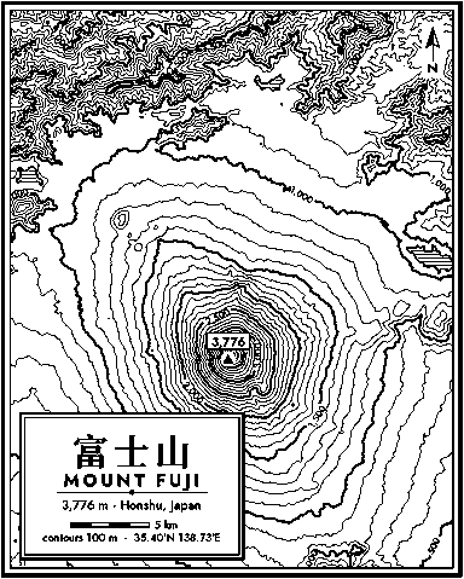
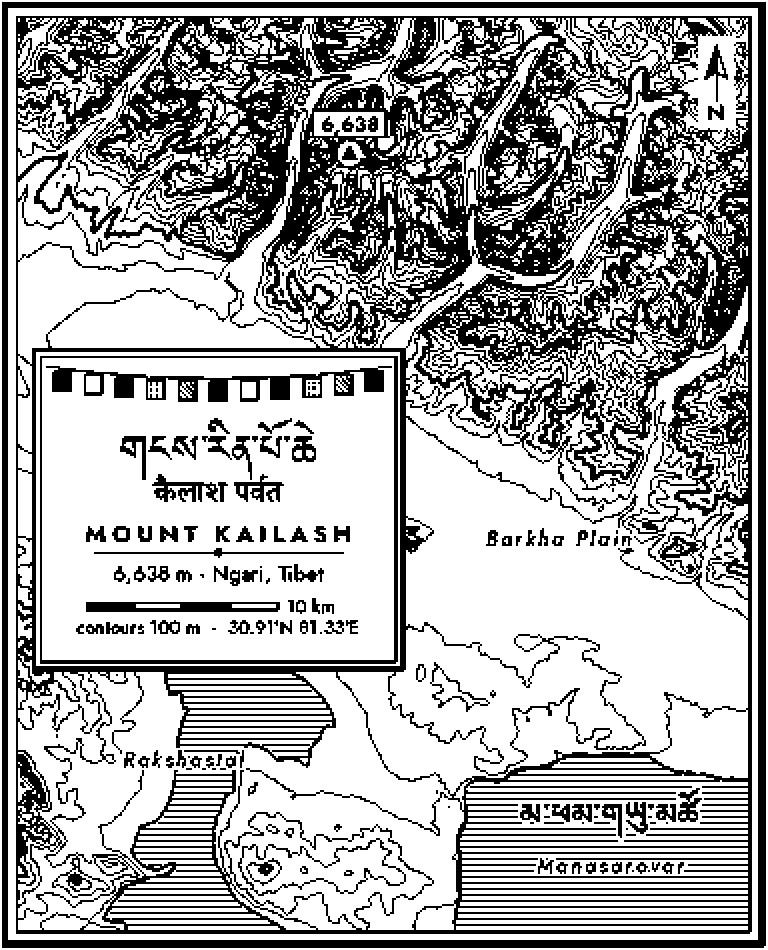
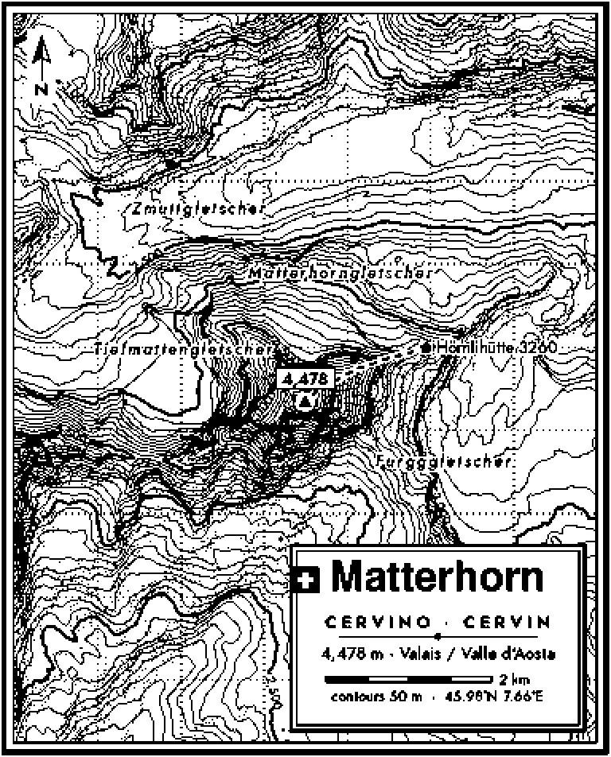
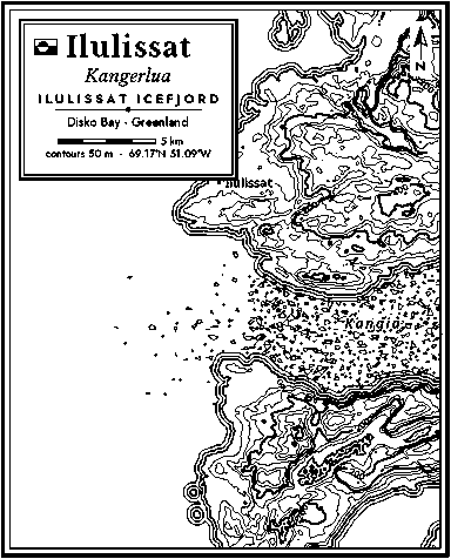
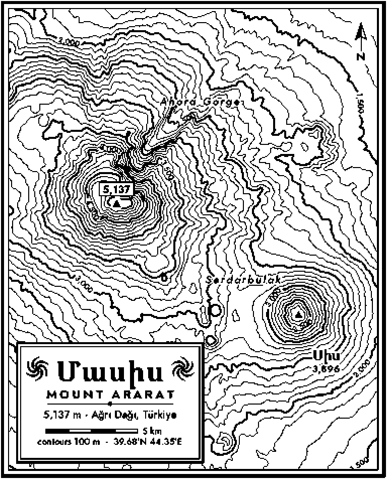
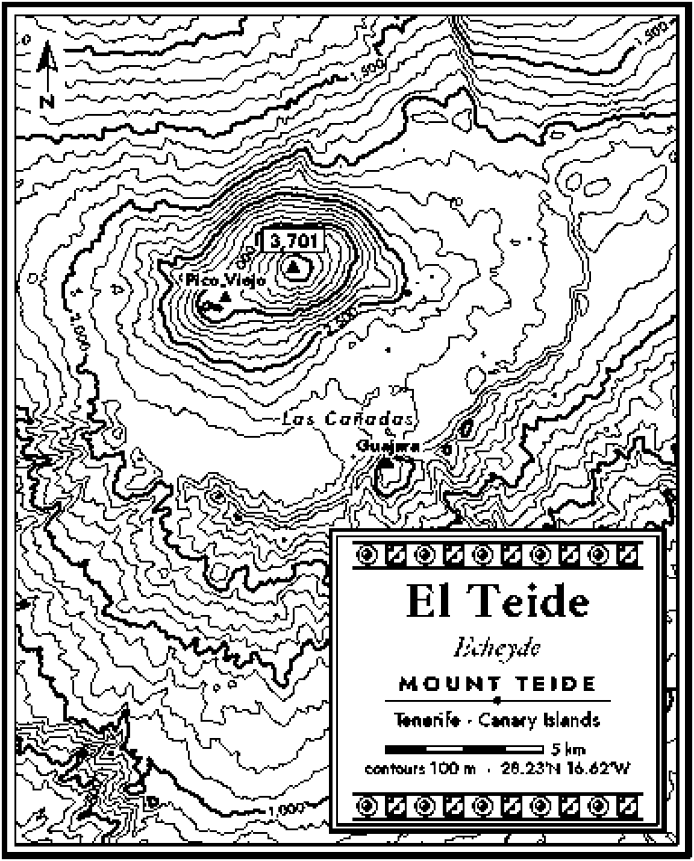
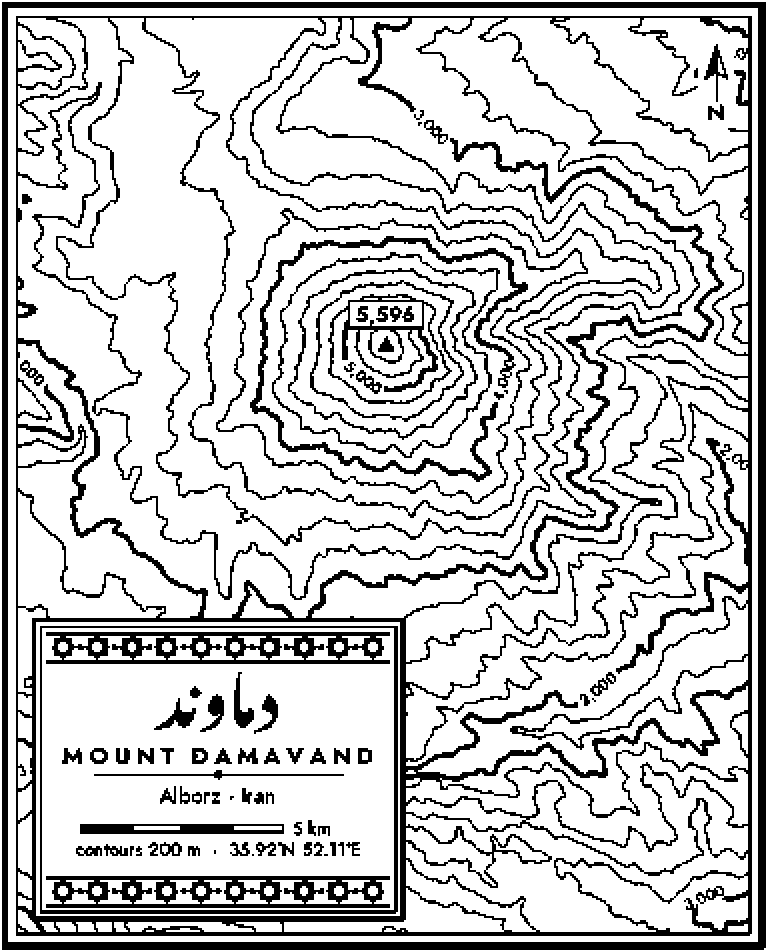
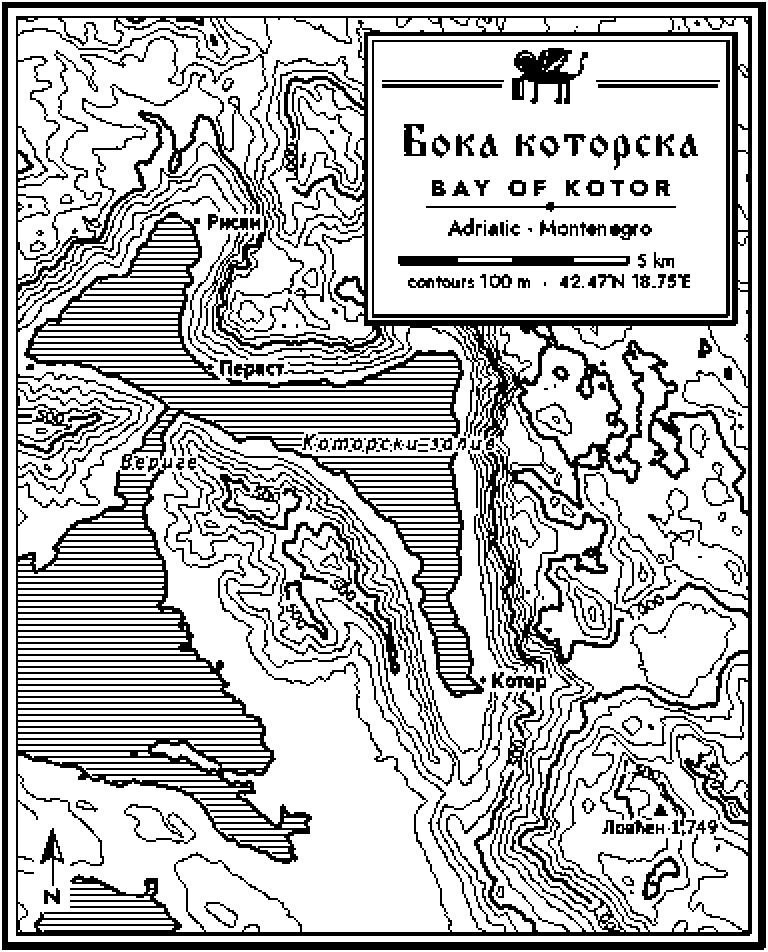
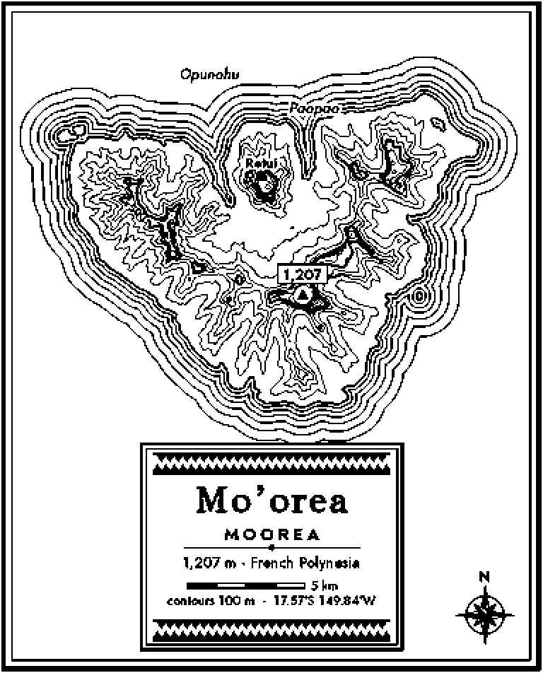
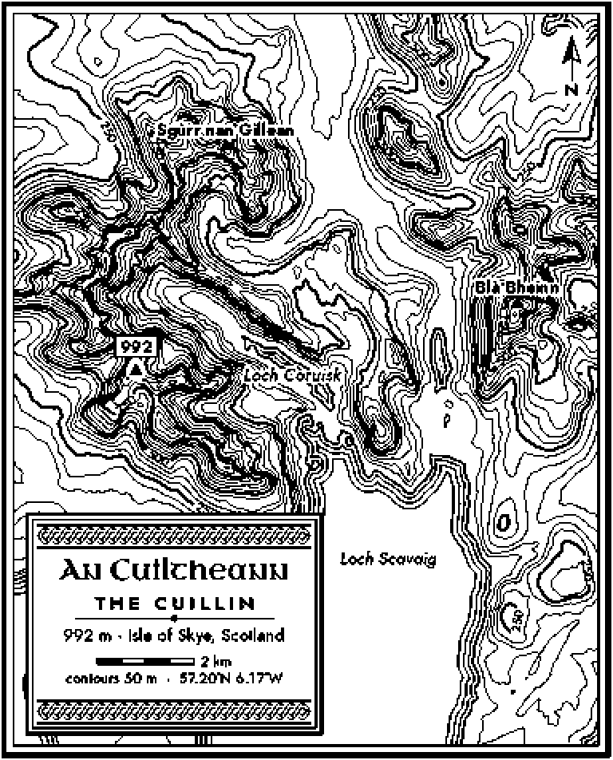

# liltopomaps

Little "playing card" terrain maps of real places, made by a [Claude Code](https://claude.com/claude-code) skill.

Each card is 384 dots wide and 1-bit: a contour map drawn from open elevation data, framed like an old survey
sheet, with an inset cartouche carrying the place's name in its own script and a local ornament: Greek key friezes
for Santorini, prayer flags for Kailash, a Swiss cross and km grid for the Matterhorn.

<table>
  <tr>
    <td align="center" width="33%"><br>
      <sub><b>Santorini</b>: the caldera rim, Greek key friezes, engraved water-lining</sub></td>
    <td align="center" width="33%"><br>
      <sub><b>Mount Fuji</b>: 富士山 in a mincho serif, the near-perfect cone</sub></td>
    <td align="center" width="33%"><br>
      <sub><b>Mount Kailash</b>: Tibetan and Devanagari names, prayer flags, the sacred lakes</sub></td>
  </tr>
  <tr>
    <td align="center"><br>
      <sub><b>Matterhorn</b>: swisstopo survey data, Swiss cross, km grid, the Hörnli route</sub></td>
    <td align="center"><br>
      <sub><b>Ha Long Bay</b>: white karst islands on a hatched sea, Dong Son drum bands</sub></td>
    <td align="center"><br>
      <sub><b>Ilulissat Icefjord</b>: iceberg symbols fanning out of the fjord, Greenland flag</sub></td>
  </tr>
  <tr>
    <td align="center"><br>
      <sub><b>Mount Ararat</b>: Armenian Մասիս between eternity signs, Little Ararat alongside</sub></td>
    <td align="center"><br>
      <sub><b>Teide</b>: the volcano over the Las Cañadas caldera, Canarian pintadera stamps</sub></td>
    <td align="center"><br>
      <sub><b>Mount Damavand</b>: دماوند in Nastaliq, the lone cone of the Alborz, Persian girih stars</sub></td>
  </tr>
  <tr>
    <td align="center"><br>
      <sub><b>Bay of Kotor</b>: early Cyrillic after the Cetinje press, the winged lion of St Mark</sub></td>
    <td align="center"><br>
      <sub><b>Moorea</b>: the island and its two bays, Tahitian tatau shark-teeth bands</sub></td>
    <td align="center"><br>
      <sub><b>The Cuillin</b>: An Cuiltheann in insular uncial, the Black Cuillin ridge, Celtic knotwork</sub></td>
  </tr>
</table>

## The `liltopomaps` skill

`.claude/skills/liltopomaps/` makes a new card end to end: it judges whether a place has terrain worth a card,
verifies coordinates against the elevation data, picks a local typeface and ornament, places the cartouche over the
least interesting ground, self-checks the render, and opens a preview:

```
/liltopomaps moorea
/liltopomaps stromboli
```

It is deliberately terrain-only. Cities and flat places get politely turned down, with the reason and a terrain
alternative.

To use it in another project, copy the `.claude/skills/liltopomaps/` folder into that project's `.claude/skills/`
or into `~/.claude/skills/`.

## Setup

```sh
python3 -m venv .venv
.venv/bin/pip install -r .claude/skills/liltopomaps/requirements.txt
```

On macOS the cards use the system fonts (Futura, Didot, Songti and friends). Elsewhere, open-licence lookalikes
are downloaded on first use (Jost, GFS Didot, Noto, PT Sans…); the examples above were rendered with these.
A few cards use open faces with no macOS counterpart (Ibarra Real Nova, Noto Nastaliq, Monomakh, Uncial Antiqua),
downloaded the same way on every system.

## Rendering without Claude

The renderer and its helpers live in `.claude/skills/liltopomaps/scripts/`:

```sh
S=.claude/skills/liltopomaps/scripts
$S/presets.sh santorini santorini.png               # re-render a saved card
.venv/bin/python $S/preview.py santorini.png        # previews/santorini_preview.png, opened in your viewer
.venv/bin/python $S/realtopo.py --help              # every option
```

Presets: `fuji`, `matterhorn`, `santorini`, `kailash`, `pyramiden`, `ararat`, `halong`, `ilulissat`, `teide`,
`damavand`, `kotor`, `moorea`, `cuillin`.

- `realtopo.py`: the card renderer (placement, contour intervals, cartouche text/fonts/ornaments, water styles,
  labels, routes, data source).
- `check_points.py`: checks label coordinates against the elevation data before they go on a card.
- `zoom.py`: dot-level enlargement of parts of a card.
- `preview.py`: dot-exact enlargement on a paper mock-up.
- `fontfallback.py`: open-licence stand-ins for the macOS fonts, and the extra open faces.

## Data and attribution

- [Copernicus DEM GLO-30 / GLO-90](https://registry.opendata.aws/copernicus-dem/): © DLR e.V. 2010–2014 and
  © Airbus Defence and Space GmbH 2014–2018, provided under COPERNICUS by the European Union and ESA.
- [Terrain Tiles](https://registry.opendata.aws/terrain-tiles/) (Mapzen / AWS Open Data).
- [swissALTI3D](https://www.swisstopo.admin.ch/en/height-model-swissalti3d), © swisstopo, used to patch
  satellite voids on Swiss peaks.
- Fonts downloaded on first use (stand-ins where the macOS fonts are missing, plus the extra open faces): Jost,
  GFS Didot, Noto, Jomolhari, PT Sans, Libre Baskerville, Amiri, Ibarra Real Nova, Monomakh and Uncial Antiqua
  ([SIL Open Font License](https://openfontlicense.org), via
  [Google Fonts](https://github.com/google/fonts)); TeX Gyre Pagella (GUST Font License); Nimbus Sans
  ([URW base35](https://github.com/ArtifexSoftware/urw-base35-fonts)).

Downloads are cached under `~/.cache/liltopomaps`.
